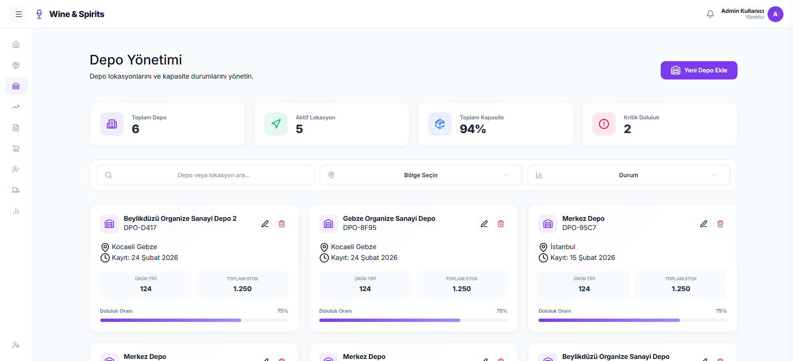
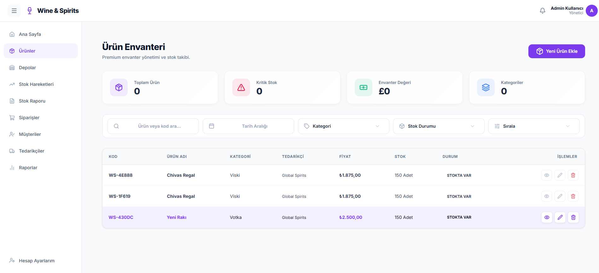
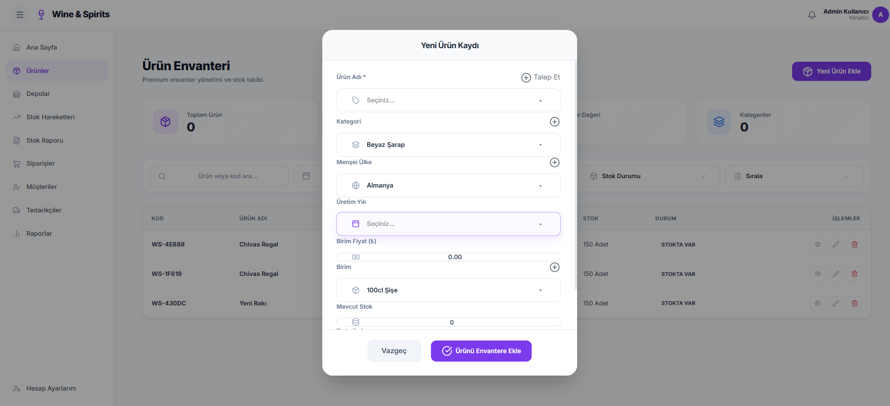
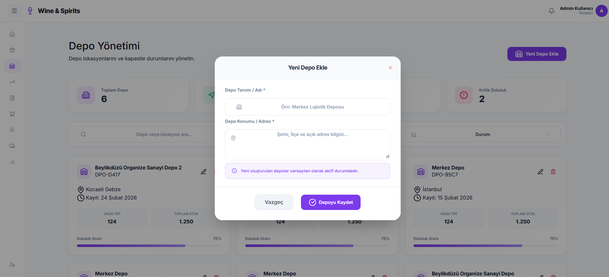
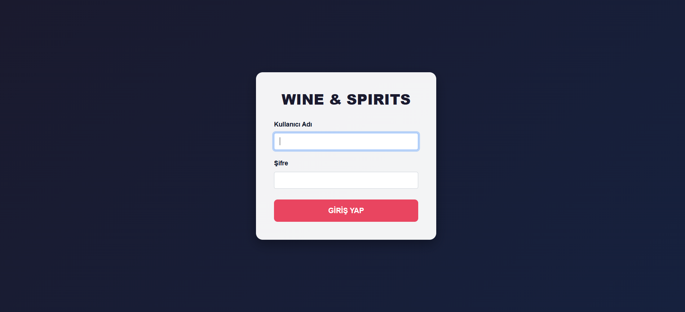
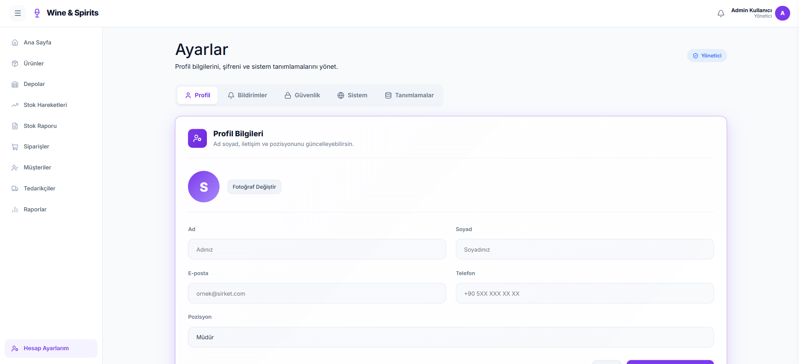

# 🍷 Wine & Spirits – ERP & CRM Yönetim Sistemi

İçecek sektöründeki bir işletmenin **stok, depo, sipariş, müşteri ve tedarikçi** süreçlerini tek bir panelden yönetmesi için geliştirilmiş, rol tabanlı yetkilendirmeye sahip bir ERP & CRM web uygulaması.

> **AI-Native geliştirme:** Bu proje; **Claude Code, Cursor ve Antigravity** gibi yapay zeka destekli geliştirme araçlarıyla tasarlanıp geliştirildi. Gereksinim analizi, veri modeli, mimari kararlar, yapay zekanın yönlendirilmesi ve çıktının test edilmesi tarafımdan yürütüldü.

## 📸 Ekran Görüntüleri

| Depo Yönetimi | Ürün Envanteri |
|---|---|
|  |  |
| **Yeni Ürün Kaydı** | **Yeni Depo Ekleme** |
|  |  |
| **Giriş Ekranı** | **Ayarlar** |
|  |  |

---

## ✨ Özellikler

| Modül | Açıklama |
|---|---|
| **Dashboard** | KPI kartları, Chart.js grafikleri ve kritik stok uyarıları içeren özet ekran |
| **Ürün & Kategori Yönetimi** | Ürün tanımları, kategoriler, birimler ve ülkeler |
| **Depo Yönetimi** | Birden fazla depo tanımı ve depo bazlı stok takibi |
| **Stok Hareketleri** | Giriş/çıkış hareketlerinin kaydı ve geçmiş takibi |
| **Stok Raporları** | Kritik stok seviyesinin altındaki ürünlerin tespiti ve envanter raporlaması |
| **Sipariş Yönetimi** | Sipariş ve sipariş kalemleri (OrderDetail) yönetimi |
| **Müşteri & Tedarikçi (CRM)** | Müşteri ve tedarikçi kayıtları ve istatistikleri |
| **Raporlar** | Kategori bazlı satış (bar) ve gelir trendi (line) grafikleri, tarih filtresi |
| **Destek Talepleri** | Kullanıcıların destek talebi oluşturabildiği modül |
| **Kullanıcı & Rol Yönetimi** | SuperAdmin, Admin, Manager ve Staff rolleriyle yetki bazlı erişim |
| **Ayarlar** | Uygulama ve kullanıcı ayarları |
| **REST API** | Dashboard istatistikleri ve ürün listesi için JSON endpoint'leri |

## 🛠️ Teknolojiler

- **Backend:** ASP.NET Core MVC (.NET 10), C#
- **Veritabanı:** Microsoft SQL Server, Entity Framework Core 10 (Database-First, EF Core Power Tools)
- **Kimlik Doğrulama:** Cookie Authentication, Claims tabanlı rol yetkilendirme, Session, özel parola hash'leme
- **Frontend:** Razor Views, JavaScript (ES6+), AJAX, Chart.js, SCSS
- **Mimari:** Ortak `BaseController` ve `BaseEntity` yapısı, soft delete, ViewModel katmanı, özel TagHelper'lar (`ws-page-header`, `ws-stat-card`)

## 🏗️ Proje Yapısı

```
Wine_Spirits/
├── Controllers/          # MVC controller'ları
│   └── Api/              # REST API controller'ları (Dashboard, Products)
├── Models/               # Entity sınıfları ve DbContext
│   └── ViewModels/       # Ekranlara özel ViewModel'ler
├── Views/                # Razor görünümleri (modül bazlı klasörler)
├── TagHelpers/           # Yeniden kullanılabilir UI bileşenleri
├── Helpers/              # Parola hash'leme yardımcıları
└── wwwroot/              # SCSS/CSS, JavaScript ve statik dosyalar
database/
└── WineSpirits_schema.sql  # Veritabanı şeması (14 tablo, ilişkiler ve varsayılan değerler)
```

## 🔌 API Endpoint'leri

| Metot | Endpoint | Açıklama |
|---|---|---|
| `GET` | `/api/dashboard/stats` | Dashboard istatistikleri |
| `GET` | `/api/products/list` | Ürün listesi |

## 🚀 Kurulum

**Gereksinimler:** .NET 10 SDK, SQL Server (LocalDB veya Express), Visual Studio 2022+ / VS Code

```bash
git clone https://github.com/erdemgltekin/Wine_Spirits.git
cd Wine_Spirits/Wine_Spirits
```

1. Veritabanını oluşturun: [`database/WineSpirits_schema.sql`](database/WineSpirits_schema.sql) dosyasını SQL Server Management Studio'da açıp çalıştırın. Script `WineSpirits` veritabanını, 14 tabloyu, ilişkileri ve varsayılan değerleri oluşturur.
2. `appsettings.json` içindeki `ConnectionStrings:DefaultConnection` değerini kendi SQL Server örneğinize göre düzenleyin.
3. Uygulamayı çalıştırın:

```bash
dotnet restore
dotnet run
```

İlk çalıştırmada sistem, yerel test için varsayılan bir **SuperAdmin** kullanıcısı oluşturur (`admin` / `123456`). Canlı ortamda bu parolanın değiştirilmesi gerekir.

## 👤 Geliştirici

**Kadir Erdem Gültekin** – Junior Full-Stack Developer · AI-Native Geliştirme

- LinkedIn: [linkedin.com/in/kadir-erdem-gültekin-27a090282](https://www.linkedin.com/in/kadir-erdem-g%C3%BCltekin-27a090282/)
- Diğer canlı projeler: [aesmartsystems.com](https://www.aesmartsystems.com) · [cetinkayahealth.com](https://cetinkayahealth.com) · [aseitex.com](http://aseitex.com)
